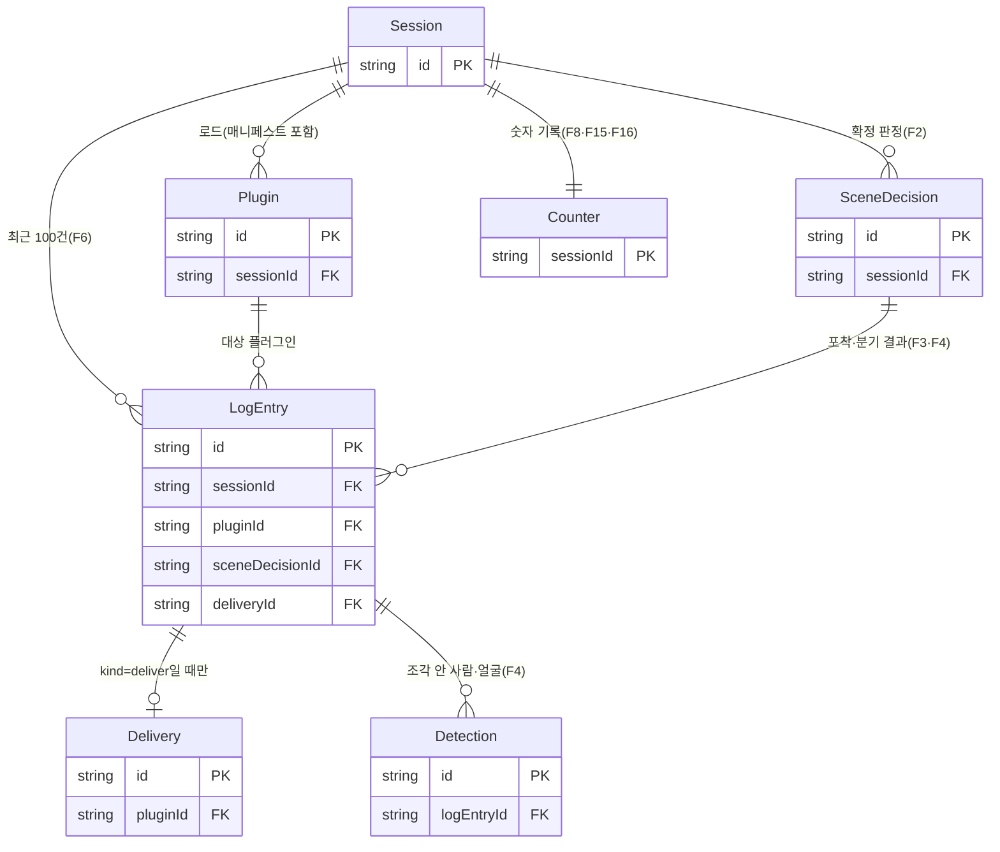

# LensGate(가칭) ERD: 축약판 (메모리 데이터 모델)

2026-10-31 · 근거: PRD(F1~F20, 분기 기준값, 카운터 정의), `00-추가결정사항.md` §4·"ERD 축약 방향" · 공통 ID: 보장 G1~G5, 기능 F#.

## 0. 이름 대응 (처음 브리프 → 이번 ERD)

| 처음 브리프 | Session | InputSource | Manifest | Plugin | SceneDecision | Capture | Delivery | FaceMask | BlockEvent | ThroughputSample |
| --- | --- | --- | --- | --- | --- | --- | --- | --- | --- | --- |
| **이번 ERD (7개)** | Session | `Session.input` | `Plugin.manifest` | Plugin | SceneDecision (제안명 SceneSnapshot) | LogEntry + Delivery | Delivery | Detection | LogEntry(`violation`) | Counter |

## 1. 저장 방침

1. **어디에:** DB는 없다. 모든 엔티티는 탭의 브라우저 메모리(zustand 스토어)에만 있다. `/api/calorie`는 무상태라 이미지를 남기지 않는다. `/outward` 창에는 `BroadcastChannel`로 Counter의 숫자만 보낸다.
2. **얼마나:** 세션(탭) 동안만. LogEntry는 최근 100건만 두고, 밀려난 항목에 딸린 Delivery·Detection도 지우며 썸네일은 `URL.revokeObjectURL`로 해제한다. Counter는 이미지 없는 숫자 기록을 따로 쌓으므로 로그가 밀려나도 숫자는 줄지 않는다. 새로고침하면 전부 사라진다.
3. **절대 저장 안 함(G1):** 원본 프레임, 가리기 전 조각, 얼굴 특징값·인물 ID·추적 ID. 포착·가림 중 픽셀 버퍼는 분기 직후 해제한다. 저장되는 픽셀은 **플러그인에 실제로 보낸 Blob의 썸네일**(`Delivery.thumbnailRef`)뿐이다. 예외는 비교 모드(F17)의 `raw` 썸네일이며 비교 모드를 끄면 즉시 해제한다.

## 2. ER 다이어그램

읽는 법: 판정(SceneDecision)은 화면 단위다. 그 장면을 원하는 플러그인마다 포착·분기를 한 번씩 하고 결과를 LogEntry 한 줄로 남긴다. 실제로 보낸 경우에만 Delivery가 붙는다(2d 보류·주기 제한 → Delivery 없음). 차단(violation)은 판정과 무관하므로 `sceneDecisionId`가 비어 있다.

## 3. 엔티티별 핵심 속성

enum은 `a|b`, 시간은 `performance.now()` 기준 ms.

**Session**. 탭 하나의 실행 단위. InputSource를 속성으로 품는다.

| 속성 | 타입 | 출처 |
| --- | --- | --- |
| id (PK) | string | — |
| startedAt | number | — |
| viewMode | `phone\|desktop\|hud\|outward` | F8, F15 |
| input | {kind: `webcam\|rear\|video`, width, height, fps, fallbackFrom: kind\|null} | F1, F10 |
| compareMode | bool | F17 |
| paused | bool (전달 일시 정지, 발표자 화면 전용) | F20 |

**Plugin**. Manifest를 속성으로 품는다. 매니페스트가 바뀌면 iframe을 다시 만들고 `manifest.version`을 올린다. 검증 실패 시 기존 값 유지.

| 속성 | 타입 | 출처 |
| --- | --- | --- |
| id (PK), sessionId (FK) | string | — |
| runtimeId | string (iframe을 새로 만들 때마다 바뀜) | F5, F11 |
| kind | `calorie\|tamper\|hello`(개발용). `reader`는 F18 이번 제출 제외 | F7, F13 |
| status / gateOpen | `loading\|ready\|stopped\|terminated` (`stopped` = 전환 실패, 사용자가 다시 켜야 풀림) / bool (전달 게이트) | F5 |
| cooldownUntil / busy | number / bool (포착 진행 중) | F3 |
| manifest.version | int | F11 |
| manifest.purpose / scenes / region | string ≤40자 / (`food\|person`)[] / `target`만 | F2, F11 |
| manifest.maxSide / quality / maxPerMinute | int 32–512 / float 0.5–0.92 / int 1–30 | F3, F11 |
| manifest.network / allowedOrigins | string[] 요청(https origin만, `$ORIGIN` 치환) / 파생: `network` ∩ `HOST_ALLOWED_ORIGINS` | F5, F14 |

**SceneDecision** (= SceneSnapshot). 1초 유지로 *확정된* 0단계 판정만. 5fps 개별 판정은 Counter 실행 횟수로만 남는다. HUD의 실시간 대상 박스와 "화면 속 N명"은 저장 엔티티가 아니라 UI 상태(`liveObservation`)다.

| 속성 | 타입 | 출처 |
| --- | --- | --- |
| id (PK), sessionId (FK) | string | — |
| label | `food\|person\|none` 장면 분류(음식 우선) | F2 |
| objectLabel | string, COCO 영문(`banana` 등). `x-label`·고정표 키 | F2, F7 |
| targetBox | {x,y,w,h} 프레임 기준 0~1 | F2, F3 |
| score | float | F2 |
| confirmedAt | number | F2 |

**LogEntry**. 증명 로그 한 줄. 전달·보류·전달 안 함·차단을 한 표에 담는다(BlockEvent·Capture 흡수).

| 속성 | 타입 | 출처 |
| --- | --- | --- |
| id (PK), sessionId (FK), pluginId (FK) | string | — |
| sceneDecisionId (FK) / deliveryId (FK) | string \| null | F3 / F6 |
| kind | `deliver\|hold\|skip\|violation` | F4, F5, F6 |
| branch | `2a\|2b\|2c\|2d\|raw` \| null (`raw` = 비교 모드, `2d` = hold) | F4, F17 |
| reason | string (예: "주기 제한", "출구 재검사", "검사 실패", "카메라 요청"; `fetch`·`script` violation은 호스트가 대상 origin을 `network`와 대조해 "허용 목록 밖" 또는 "허용 목록 안인데 실패"를 붙임). `skip`은 같은 사유 10초에 1번만 | F3, F13, F14 |
| enforcedBy | `plugin-report`(변조 4종) \| `host`(iframe 재로드·해시 불일치) \| null | F5, F13 |
| at | number | F6 |

**Delivery**. 중개기가 플러그인에 `delivery` 메시지로 **실제로 보낸** Blob 1개(G5). 숫자는 모두 이 Blob에서 잰다.

| 속성 | 타입 | 출처 | 계산 근거 |
| --- | --- | --- | --- |
| id (PK), pluginId (FK) | string | F12 | |
| manifestVersion | int | F11 | 보낸 시점의 `Plugin.manifest.version` |
| objectLabel | string | F7 | SceneDecision에서 복사, `x-label`·고정표 키 |
| sendStatus | `prepared\|dispatched\|failed` | F6 | `dispatched`만 전달 수·Counter에 들어간다 |
| branch | `2a\|2b\|2c\|raw` | F4, F6 | |
| bytes | int | F6 | 보낸 Blob의 `size` |
| areaRatio (+ cropRect) | float, {x,y,w,h} 원본 px | F6 | **실제로 자른** cropRect 면적 / 원본 프레임 면적(판정기 `targetBox` 아님) |
| facesMasked | int | F6 | 같은 LogEntry의 Detection 중 `masked≠none` 수(가림 적용 기록) |
| faceCheck | `{status:'checked', detectedFaces:int} \| {status:'error', detectedFaces:null}` | F4, F8 | 출구 재검사(P0, JPEG 후 BlazeFace), 두 모드 공통. 보호 모드에서 ≥1이면 hold("출구 재검사"), error면 hold("검사 실패")라 Delivery 없음. `raw`는 전체 프레임 얼굴 수 |
| processedAt, location | number, `browser` (처리 위치, GPS 아님) | F6 | `phone\|glasses\|enterprise`는 발표 그림용, 데모에서는 안 씀 |
| sha256 / ackSha256 / ackStatus | hex / hex / `pending\|match\|mismatch\|timeout` | F6 | 호스트 값 / 플러그인 `ack` 값 / 2초 안 ack 없으면 timeout(IF-04). 무결성 확인용일 뿐 |
| thumbnailRef | object URL | F6, F12 | 보낸 Blob을 줄인 것 |

**Detection**. 조각 안의 사람·얼굴 박스(FaceMask 흡수, 좌표·점수만). `person`은 0단계가 아니라 1단계 포착 프레임에서 다시 검출한 것이다.

| 속성 | 타입 | 출처 |
| --- | --- | --- |
| id (PK), logEntryId (FK) | string | — |
| kind | `person\|face` | F4 |
| box | {x,y,w,h} 조각 기준 0~1 | F4 |
| score | float (얼굴 0.5 기준) | F4 |
| overlap | float (사람 박스 ∩ 조각 / 조각, 5%·50% 기준) \| null | F4 |
| masked | `none\|face\|head` (2b 15% 확장 6×6 / 2c 위 40%·좌우 10%) | F4 |

**Counter**. 세션당 1개. `dispatched` 전달과 보류 때마다 **이미지 없는 숫자 기록**을 쌓는다. Delivery 행을 읽지 않으므로 로그 100건이 밀려나도 줄지 않는다. ThroughputSample을 흡수했다.

| 속성 | 타입 | 출처 |
| --- | --- | --- |
| sessionId (PK·FK) | string | — |
| recent10s | {at, pluginId, detectedFaces}[] (10초 지나면 빠짐. 비교 모드를 꺼도 빼지 않는다) | F8, F15 |
| window60s | {stage0Runs, faceDetectRuns, sourceFrames, deliveries, holds} 직전 60초 (얼굴 검출 = 전달당 가림 1 + 재검사 1) | F3, F16 |
| perPlugin | {pluginId: {deliveries, faceDeliveries}} 증가 전용 | F6, F12 |
| rawServerSends | int (원본 서버 전송, 항상 0) | F16, F17 |
| apiSends | int (가린 조각의 허용 API 전송 수) | F7, F16 |

## 4. 파생값 계산 (Counter)

| 값 | 계산 (쿼리처럼) | 화면 |
| --- | --- | --- |
| HUD M | `MAX(detectedFaces) FROM recent10s` (없으면 0) | F8, 0=초록·≥1=주황 |
| 세션 누적 | `perPlugin[p].faceDeliveries` (`dispatched`이고 detectedFaces>0이면 +1) | F6, "얼굴이 담긴 전달 N건" |
| 확인 화면 N장 | `perPlugin[p].deliveries` (`dispatched`이면 +1) | F12 |
| 바깥 표시 N개 | `COUNT(DISTINCT pluginId) FROM recent10s WHERE detectedFaces>0` | F15 |
| 처리량 비율 | `(stage0Runs + faceDetectRuns) / (2 × sourceFrames)` in `window60s` | F16 |

- **세션 누적의 한계:** 인물 인식이 비목표라 서로 다른 사람 수가 아니라 전달 건수를 센다(같은 사람이 여러 번 담기면 여러 건).
- **F12와 100건 제한:** 100장을 넘으면 그리드 끝에 "외 k장(썸네일 해제됨)"을 붙여 `deliveries`와 맞춘다.
- **G5:** Counter 기록은 `dispatched` Delivery의 `faceCheck`에서만 쌓는다(판정기 값 아님).
- **비교 모드 종료:** `raw` 기록을 창에서 빼지 않는다. M·K는 10초가 지나며 0이 되고, `raw` 썸네일만 즉시 해제한다.

## 5. 이번엔 뺀 것

| 뺀 것 | 이유 |
| --- | --- |
| 사용자 계정·로그인 | URL로 바로 여는 데모. 서버 DB가 필요해진다 |
| 동의 등록·인물 브리핑·`consentedIds` | PRD 비목표. 얼굴 특징값을 저장하는 순간 생체정보를 다룬다 |
| 얼굴 특징값·인물 ID·추적 ID | 같은 이유. 세션 누적은 전달 건수로 센다 |
| 원본 프레임·가리기 전 조각 | G1. 일시 버퍼로만 존재 |
| 5fps 개별 판정 기록 | 횟수만 센다 |
| 칼로리 결과 이력 | 보장과 무관. HUD에 최신 한 줄만 둔다 |
| 허용된 외부 요청 로그 | 범위 밖. 네트워크 탭이 증거 |
| 3단계 기업 서버 데이터 | F19 비활성 |
| IndexedDB 영속화 | 세션 한정 운영과 안 맞고, 비교 모드 썸네일이 디스크에 남는다 |

## 6. 다른 문서와 맞출 점

- `Delivery.bytes` = 칼로리 호출 요청 본문 크기(F6 수용 기준)가 되려면 플러그인이 받은 Blob을 **그대로** `/api/calorie`로 보내야 한다. SSRD 플러그인 규약에 적어야 한다.
- 비교 모드(`raw`)는 칼로리 플러그인 1개에만 보내고, 그동안 칼로리 iframe은 `connect-src 'none'`이라 `raw` Blob이 서버로 가지 않는다.
- 플러그인을 다시 띄운 뒤 같은 조각을 다시 보내면 새 LogEntry와 새 Delivery를 만든다. Delivery 행은 `postMessage` 직전에 쓴다.
